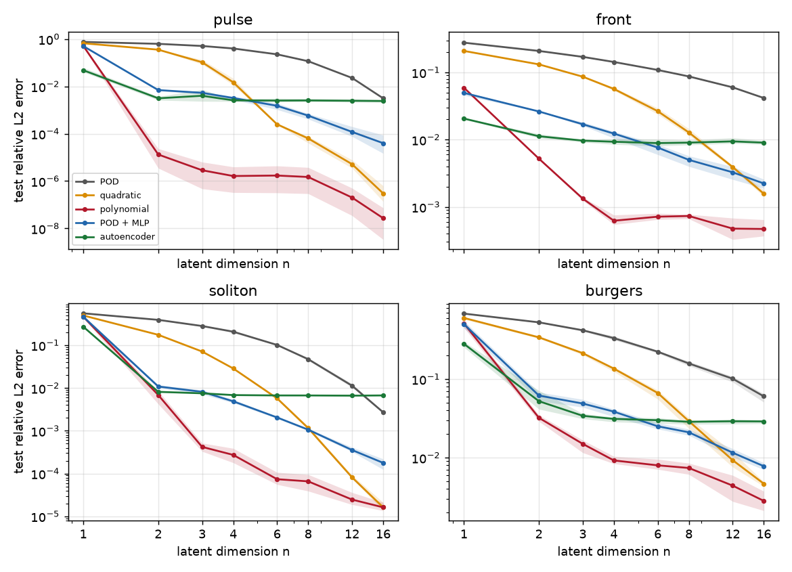
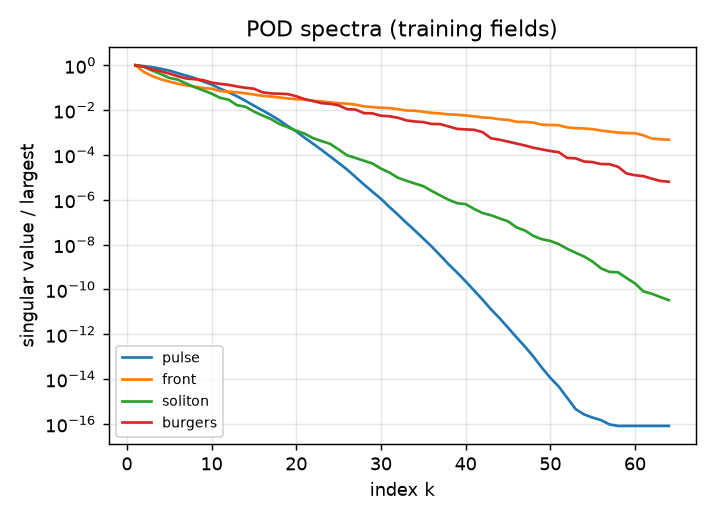
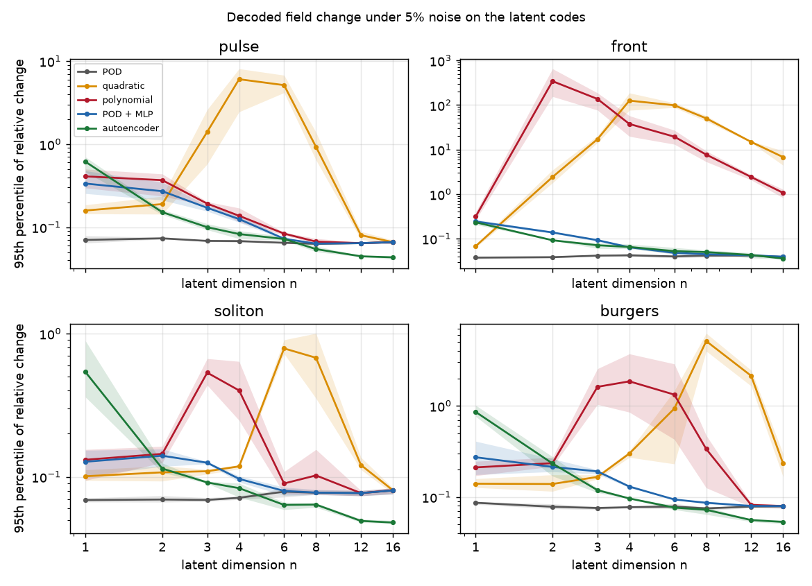
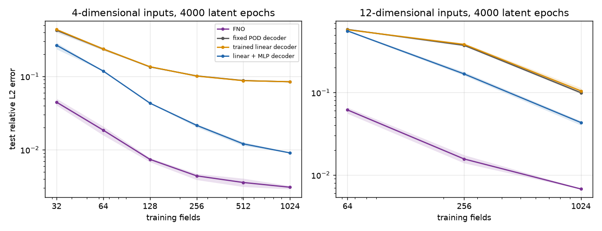

# nonlinear-rom-lab

[](https://github.com/eljandoubi/nonlinear-rom-lab/actions/workflows/ci.yml)


A numerical study of nonlinear reduced representations of PDE solutions. On four families of exact solutions it compares a linear POD basis with polynomial and neural decoders: how many latent numbers each needs, and how much latent noise each amplifies. It then uses the same ideas for operator learning on Burgers solutions with shocks, against a Fourier neural operator (FNO).

The code is PyTorch and NumPy. The reduction study ran on a laptop CPU and the operator study on one free Colab T4 (an instance in a US region; the data are generated by the code and nothing here is private). The accuracy numbers below come from `results/*.json`, and `romlab report` writes the full tables to `results/summary.md`.

## What the runs show

- A linear POD basis needs 16 modes for 1% error on the pulse and the soliton, and is still at 4.2% and 6% with 16 modes on the front and the Burgers front. A polynomial decoder on the first POD coordinates reaches 1% with 2 coordinates on the pulse, the front and the soliton and with 4 on the Burgers front, one to two times the number of parameters of each family.
- That accuracy has a price. At 4 coordinates the polynomial decoder changes the decoded field by a median 317% of its norm on the front and 46% on the Burgers front when each latent code gets noise of 5% of its spread. POD, a neural decoder on POD coordinates and an autoencoder stay between 1.8% and 6.5%. Choosing the degree and the ridge on reconstruction error alone did not prevent it.
- With one latent number a linear encoder cannot unfold the pulse family (51% error for the polynomial decoder). An autoencoder with a nonlinear encoder reaches 4.8%.
- Operator learning on Burgers solutions with shocks, with 1024 training fields and 4 input numbers: a latent model with a fixed POD decoder reaches 8.4%, one with a nonlinear decoder of the same latent size 0.9% (0.39% after five times more epochs), and an FNO 0.31%. With 12 input numbers and 1024 fields the same three reach 10%, 4.3% (3.5%) and 0.68%.
- The FNO is the most accurate model at every training size in both settings, by a wide margin below 256 fields. The nonlinear decoder gets within a factor 1.3 of it with 4 input numbers after the longer training and stays 5 times behind with 12. Its gain over the linear decoders comes from the nonlinearity, not from training the decoder.

## Setting

### Solution families

Four families with a closed-form expression, sampled on a fixed grid of 256 points. The fields are exact, so the only error is the error of the reduction. Parameters are drawn uniformly in a box; the test parameters are fresh draws from the same box, so the test measures interpolation inside the box and nothing else.

| family | solution | parameters | intrinsic dimension |
|---|---|---|---|
| `pulse` | Gaussian bump of width 0.04 at a given centre, on [0, 1] | centre in [0.2, 0.8] | 1 |
| `front` | tanh front of thickness 0.01 on [0, 1] (the profile of a viscous shock) | position in [0.2, 0.8] | 1 |
| `soliton` | KdV one-soliton on [0, 20], height c / 2 and width of order 1 / sqrt(c) | speed in [1, 4], position in [6, 14] | 2 |
| `burgers` | Cole-Hopf solution of viscous Burgers (nu = 0.02) at t = 0 on the periodic unit interval, shifted | amplitude eps in [0.90, 0.995], shift in [-0.25, 0.25] | 2 |

The soliton and the Burgers front are checked against their PDEs in the tests (residuals of the closed forms), so a typo in a formula cannot pass.

### Reducers

Each reducer maps a field to n latent numbers (encoder) and back (decoder), and is fitted on 128 training fields. 64 validation fields choose the polynomial degree and ridge and the epoch of the networks. 256 test fields from fresh parameters score the result with the mean relative L2 error. Three seeds change the parameter draws and the network initialisation.

| name | encoder | decoder |
|---|---|---|
| POD | orthogonal projection on the first n singular vectors | linear |
| quadratic | POD coordinates | POD plus a quadratic polynomial of the coordinates (Legendre features, ridge penalty chosen on validation) |
| polynomial | POD coordinates | the same with a total degree 1 to 12 chosen on validation |
| POD + MLP | POD coordinates | POD plus an MLP correction that starts at zero |
| autoencoder | MLP | MLP |

### Decoder sensitivity

Two numbers per fitted decoder, computed on the codes of the test fields. The first is the relative change of the decoded field when each code gets Gaussian noise of 5% of its spread. The second is the spectral norm of the decoder Jacobian in latent coordinates scaled to unit spread (central differences), relative to the mean field norm. Both are empirical stand-ins for the Lipschitz constant of the decoder; nothing is proven here.

### Operator task

Burgers with nu = 0.02 on the periodic unit interval, from an initial field to the field at T = 0.4, after the shocks have formed. Initial fields are random trigonometric polynomials with 2 modes (4 numbers, `operator_k2`) or 6 modes (12 numbers, `operator_k6`), with coefficients of standard deviation 0.8 / k. The solver is a Fourier pseudo-spectral integrating-factor RK4 scheme with the 2/3 rule, run on a grid twice as fine as the one the models see. The tests check it against the Cole-Hopf solution, its convergence in time (the error falls by more than 100 when the step is divided by 4) and the conservation of the mean.

Four models, all trained by Adam with a cosine schedule on the same nested training sets (the set of size m is the first m fields of one pool), with validation fields for early stopping and for the choice of the latent size:

| model | input | latent | decoder |
|---|---|---|---|
| FNO | the field on 256 points | none | 4 spectral layers, width 32, 16 modes |
| fixed POD decoder | POD coordinates of the input | n_z numbers from an MLP | POD basis of the training outputs, not trained |
| trained linear decoder | same | same | the same basis as a starting point, trained |
| linear + MLP decoder | same | same | the same, plus an MLP correction that starts at zero |

The three latent models share the input encoder and the MLP; only the decoder differs, so the differences between them are differences of the decoder.

Two more checks use the same data. The first reconstructs the true test outputs with the reducers of the reduction study (fitted on the training outputs, each with its own encoder), to see what the bottleneck costs apart from the map from the input to the code. The second trains the POD-decoder and nonlinear-decoder models five times longer on the largest training set, to see whether the 4,000-epoch budget limits them.

## Results

### Error against latent dimension



Mean relative L2 error on the test fields against the latent dimension n, for the five reducers. Bands show the minimum and the maximum over the three seeds. `results/summary.md` has the table for every n. Smallest n with a mean test error below 1%:

| family | POD | quadratic | polynomial | POD + MLP | autoencoder |
|---|---|---|---|---|---|
| pulse | 16 | 6 | 2 | 2 | 2 |
| front | >16 | 12 | 2 | 6 | 3 |
| soliton | 16 | 6 | 2 | 3 | 2 |
| burgers | >16 | 12 | 4 | 16 | >16 |

- POD needs 16 modes on the pulse and the soliton and does not get there on the front and the Burgers front. Between n = 2 and 16 its error falls like n^-0.8 on the front and n^-1.0 on the Burgers front, against n^-2.4 on the pulse and n^-2.3 on the soliton.
- A polynomial decoder on POD coordinates needs 2 coordinates on the pulse, the front and the soliton (0.0013%, 0.52% and 0.69%) and 4 on the Burgers front (0.92%). The quadratic decoder needs 6 to 12.
- With n = 1 the polynomial and POD + MLP decoders fail on the pulse (51% and 50%): the first POD coordinate is not monotone in the position, so one coordinate value belongs to two different pulses. On the front, where it is monotone, they reach 5.9% and 5%. The autoencoder, whose encoder is nonlinear, gets 4.8% on the pulse and 2.1% on the front.
- The autoencoder flattens early. From n = 3 or 4 on it stays near 0.26% on the pulse, 0.9% on the front, 0.67% on the soliton and 2.9% on the Burgers front, while the polynomial decoders keep improving with n. It was not tuned.



The singular values show why. The pulse and the soliton are smooth in their parameters and their spectra fall fast; the front and the Burgers front have a moving sharp feature and their spectra fall slowly.

### Sensitivity of the decoders



The figure shows, for every n, the 95th percentile over the test fields of the relative change of the decoded field when each latent code gets noise of 5% of its spread. The table gives the median and the 95th percentile at n = 4, and the 95th percentile of the decoder Jacobian spectral norm in unit-spread latent coordinates, relative to the mean field norm:

| family | decoder | test error | noise median | noise p95 | Jacobian p95 |
|---|---|---|---|---|---|
| pulse | POD | 0.4 | 0.039 | 0.068 | 0.44 |
| pulse | quadratic | 0.015 | 1.9 | 6.1 | 85 |
| pulse | polynomial | 1.6e-06 | 0.054 | 0.14 | 2.5 |
| pulse | POD + MLP | 0.0032 | 0.063 | 0.13 | 1.5 |
| pulse | autoencoder | 0.0026 | 0.041 | 0.083 | 0.88 |
| front | POD | 0.14 | 0.018 | 0.042 | 0.35 |
| front | quadratic | 0.057 | 21 | 1.3e+02 | 1.6e+03 |
| front | polynomial | 6.2e-04 | 3.2 | 38 | 9e+02 |
| front | POD + MLP | 0.012 | 0.03 | 0.064 | 0.82 |
| front | autoencoder | 0.0093 | 0.027 | 0.065 | 0.86 |
| soliton | POD | 0.21 | 0.036 | 0.071 | 0.54 |
| soliton | quadratic | 0.029 | 0.061 | 0.12 | 1.5 |
| soliton | polynomial | 2.7e-04 | 0.13 | 0.4 | 5.3 |
| soliton | POD + MLP | 0.0049 | 0.043 | 0.097 | 0.81 |
| soliton | autoencoder | 0.0068 | 0.035 | 0.083 | 0.74 |
| burgers | POD | 0.33 | 0.041 | 0.077 | 0.55 |
| burgers | quadratic | 0.14 | 0.13 | 0.3 | 3.4 |
| burgers | polynomial | 0.0092 | 0.46 | 1.9 | 30 |
| burgers | POD + MLP | 0.039 | 0.065 | 0.13 | 1.7 |
| burgers | autoencoder | 0.031 | 0.044 | 0.096 | 0.84 |

The polynomial decoders are the most accurate and the least stable. Amplification depends on the family and peaks at intermediate n, where the decoder has the most freedom away from the one- or two-dimensional set that the training codes lie on. Of the 192 polynomial and quadratic fits, 176 kept the smallest of the five ridge values offered on validation fields: validation scores reconstruction, not stability.

### Operator learning, 4 input numbers



Test error with the latent size chosen on validation fields (mean over three seeds, range in brackets). 4000 epochs for the latent models and 5000 steps for the FNO.

| training fields | FNO | fixed POD decoder | trained linear decoder | linear + MLP decoder |
|---|---|---|---|---|
| 32 | 0.044 (0.04 to 0.05) | 0.42 (0.4 to 0.44) | 0.44 (0.43 to 0.44) | 0.27 (0.23 to 0.29) |
| 64 | 0.018 (0.016 to 0.021) | 0.24 (0.23 to 0.24) | 0.24 (0.23 to 0.25) | 0.12 (0.12 to 0.12) |
| 128 | 0.0074 (0.0068 to 0.0077) | 0.13 (0.13 to 0.13) | 0.14 (0.13 to 0.14) | 0.043 (0.043 to 0.043) |
| 256 | 0.0044 (0.0039 to 0.0047) | 0.1 (0.1 to 0.1) | 0.1 (0.099 to 0.1) | 0.022 (0.02 to 0.022) |
| 512 | 0.0036 (0.0031 to 0.0041) | 0.088 (0.087 to 0.088) | 0.087 (0.087 to 0.088) | 0.012 (0.011 to 0.013) |
| 1024 | 0.0031 (0.0029 to 0.0032) | 0.084 (0.084 to 0.085) | 0.085 (0.084 to 0.085) | 0.009 (0.009 to 0.0091) |

Parameters:

| model | latent size | parameters |
|---|---|---|
| FNO | none | 139,745 |
| fixed POD decoder | 2 | 17,410 |
| fixed POD decoder | 4 | 17,668 |
| fixed POD decoder | 8 | 18,184 |
| trained linear decoder | 2 | 18,178 |
| trained linear decoder | 4 | 18,948 |
| trained linear decoder | 8 | 20,488 |
| linear + MLP decoder | 2 | 117,378 |
| linear + MLP decoder | 4 | 118,404 |
| linear + MLP decoder | 8 | 120,456 |

Differences of test error (first minus second, negative means the first is better), mean with a 95% bootstrap interval over test fields pooled over seeds:

| training fields | FNO minus fixed POD decoder | linear + MLP decoder minus FNO | linear + MLP decoder minus trained linear decoder | linear + MLP decoder minus fixed POD decoder |
|---|---|---|---|---|
| 32 | -0.38 [-0.39, -0.37] | 0.22 [0.21, 0.24] | -0.17 [-0.18, -0.16] | -0.16 [-0.17, -0.15] |
| 64 | -0.22 [-0.23, -0.21] | 0.1 [0.093, 0.11] | -0.12 [-0.12, -0.11] | -0.12 [-0.12, -0.11] |
| 128 | -0.13 [-0.13, -0.12] | 0.036 [0.034, 0.038] | -0.092 [-0.096, -0.089] | -0.092 [-0.095, -0.088] |
| 256 | -0.097 [-0.1, -0.094] | 0.017 [0.016, 0.019] | -0.08 [-0.082, -0.077] | -0.08 [-0.083, -0.078] |
| 512 | -0.084 [-0.087, -0.081] | 0.0084 [0.0077, 0.0092] | -0.075 [-0.078, -0.073] | -0.076 [-0.078, -0.073] |
| 1024 | -0.081 [-0.084, -0.078] | 0.006 [0.0055, 0.0064] | -0.075 [-0.078, -0.073] | -0.075 [-0.078, -0.073] |

- The FNO is the most accurate at every size: 4.4% with 32 fields and 0.31% with 1024, against 27% and 0.9% for the nonlinear decoder.
- The nonlinear decoder is better than both linear decoders at every size, with intervals that exclude zero. The fixed POD basis and the trained linear decoder behave the same, so training a linear decoder end to end buys nothing; the nonlinearity does.
- Latent size: at 1024 fields the nonlinear decoder gets 0.97% with 4 numbers and 0.9% with 8, the dimension of the input family and twice it; the fixed POD decoder gets 23% and 8.4%.

Longer training of the latent models (20,000 epochs instead of 4,000, one seed, latent sizes 4 and 8):

| training fields | fixed POD decoder | linear + MLP decoder |
|---|---|---|
| 128 | 0.13 (0.13 to 0.13) | 0.045 (0.045 to 0.045) |
| 1024 | 0.08 (0.08 to 0.08) | 0.0039 (0.0039 to 0.0039) |

Reconstruction of the true test outputs from n_z numbers, with each reducer's own encoder (one seed). It shows what the bottleneck costs, apart from the map from the input to the code; it is not a strict bound, since the operator models train their decoders end to end:

| latent size | POD | POD + MLP | autoencoder |
|---|---|---|---|
| 2 | 0.44 | 0.19 | 0.16 |
| 4 | 0.23 | 0.015 | 0.011 |
| 8 | 0.078 | 0.0028 | 0.0092 |

With 4 numbers the nonlinear decoders lose 1.1% to 1.5% on the true outputs, more than the 0.31% that the FNO reaches in total with no bottleneck.

### Operator learning, 12 input numbers

Same protocol with 6 trigonometric modes in the input (12 numbers), latent sizes 6, 12 and 24, and three training sizes.

| training fields | FNO | fixed POD decoder | trained linear decoder | linear + MLP decoder |
|---|---|---|---|---|
| 64 | 0.062 (0.056 to 0.066) | 0.58 (0.58 to 0.59) | 0.58 (0.57 to 0.59) | 0.56 (0.55 to 0.57) |
| 256 | 0.016 (0.014 to 0.017) | 0.37 (0.36 to 0.38) | 0.38 (0.38 to 0.4) | 0.17 (0.16 to 0.18) |
| 1024 | 0.0068 (0.0067 to 0.0068) | 0.1 (0.097 to 0.1) | 0.1 (0.097 to 0.11) | 0.043 (0.04 to 0.045) |

Parameters:

| model | latent size | parameters |
|---|---|---|
| FNO | none | 139,745 |
| fixed POD decoder | 6 | 18,950 |
| fixed POD decoder | 12 | 19,724 |
| fixed POD decoder | 24 | 21,272 |
| trained linear decoder | 6 | 20,742 |
| trained linear decoder | 12 | 23,052 |
| trained linear decoder | 24 | 27,672 |
| linear + MLP decoder | 6 | 120,454 |
| linear + MLP decoder | 12 | 123,532 |
| linear + MLP decoder | 24 | 129,688 |

| training fields | FNO minus fixed POD decoder | linear + MLP decoder minus FNO | linear + MLP decoder minus trained linear decoder | linear + MLP decoder minus fixed POD decoder |
|---|---|---|---|---|
| 64 | -0.52 [-0.54, -0.51] | 0.5 [0.48, 0.52] | -0.019 [-0.025, -0.012] | -0.024 [-0.031, -0.016] |
| 256 | -0.36 [-0.37, -0.35] | 0.15 [0.15, 0.16] | -0.22 [-0.22, -0.21] | -0.21 [-0.21, -0.2] |
| 1024 | -0.093 [-0.096, -0.089] | 0.037 [0.035, 0.038] | -0.061 [-0.064, -0.059] | -0.056 [-0.059, -0.054] |

- With 64 fields none of the latent models learns the map (56% to 58%, against 100% for predicting a zero field). The nonlinear decoder is ahead of the linear ones from 256 fields on (17% against 37% and 38%), and the FNO is ahead of all of them (1.6%).

Longer training (20,000 epochs, 1024 fields, one seed, latent sizes 12 and 24):

| training fields | fixed POD decoder | linear + MLP decoder |
|---|---|---|
| 1024 | 0.1 (0.1 to 0.1) | 0.035 (0.035 to 0.035) |

Reconstruction of the true test outputs (one seed):

| latent size | POD | POD + MLP | autoencoder |
|---|---|---|---|
| 6 | 0.14 | 0.0089 | 0.014 |
| 12 | 0.031 | 0.0012 | 0.01 |
| 24 | 0.0022 | 7.8e-05 | 0.011 |


## Limits

- One space dimension on one fixed grid per family, no variable geometry. The families have 1 or 2 parameters and the operator inputs 4 or 12, so they are low-dimensional problems; nothing here says how the methods scale to 2D or 3D fields.
- The solution families are exact. Real simulation data would add solver error, noise and irregular sampling.
- Three seeds. The ranges shown are the minimum and maximum over seeds, not confidence intervals.
- Hyperparameters were set once and not tuned per method: 2,000 epochs for the reduction study and 4,000 for the operator study, Adam with a learning rate of 2e-3 (1e-3 for the FNO), MLP widths of 128 to 256. The autoencoder plateaus early on three families and might do better with more care. The latent operator models were not converged at 1,024 fields: with five times more epochs the nonlinear decoder went from 0.9% to 0.39% with 4 input numbers and from 4.3% to 3.5% with 12 (single seed). The FNO got 5,000 steps and may also gain from more.
- The polynomial decoders are single total-degree polynomials with a degree capped at 12. No bound on their Lipschitz constant is imposed or proven, and the sensitivity numbers show that it matters.
- The latent sizes of the operator study are chosen on validation fields, so the validation error of the chosen size is optimistic; the test fields are never used for any choice.
- The nonlinear decoder of the operator study has about six times the parameters of the linear one (table above). A linear decoder cannot use extra parameters, since its output stays in an n_z-dimensional space, but the comparison with the FNO is between models of similar size.
- The operator study ran on a free Colab T4 in a US region. The code and the data are public and generated on the spot.

## Related work

The linear-encoder, polynomial-decoder structure is the setting of Bensalah, Nouy and Soffo, "Nonlinear manifold approximation using compositional polynomial networks" ([arXiv:2502.05088](https://arxiv.org/abs/2502.05088)). Their encoder is linear, on a near-optimal linear space, and their decoder is a tree-structured composition of polynomial maps, with error and stability analyses. This repository uses one total-degree polynomial per decoder, chosen on validation data, and does not reproduce their method or their guarantees; it only measures how an unconstrained polynomial decoder behaves. The FNO follows Li et al., "Fourier Neural Operator for Parametric Partial Differential Equations" ([arXiv:2010.08895](https://arxiv.org/abs/2010.08895)).

## Reproduce

```bash
uv sync
uv run pytest
uv run romlab reduction --out results/reduction.json
uv run romlab operator --modes 2 --latent-epochs 4000 --fno-steps 5000 --out results/operator_k2.json
uv run romlab operator --modes 6 --train-sizes 64,256,1024 --latent-epochs 4000 --fno-steps 5000 --out results/operator_k6.json
uv run romlab operator --modes 2 --train-sizes 128,1024 --methods pod,nonlinear --latent-dims 4,8 --seeds 0 --latent-epochs 20000 --out results/operator_k2_long.json
uv run romlab operator --modes 6 --train-sizes 1024 --methods pod,nonlinear --latent-dims 12,24 --seeds 0 --latent-epochs 20000 --out results/operator_k6_long.json
uv run romlab ceiling --modes 2 --out results/ceiling_k2.json
uv run romlab ceiling --modes 6 --out results/ceiling_k6.json
uv run romlab report
```

The reduction study takes about 15 minutes on a laptop CPU and each reconstruction run a few minutes. The operator runs used `--device cuda` on a T4: about 80 minutes for the 4-number file and 45 for the 12-number one with the two side by side, and 17 and 12 minutes for the longer-training files. `--device auto` picks the GPU when there is one. Each results file records the library versions and the GPU name. A second run of the reduction study on the same machine gave the same numbers exactly.

## Layout

```
src/romlab/
  families.py         four exact families and the Cole-Hopf solution
  solvers.py          pseudo-spectral Burgers solver
  linear.py           POD
  polynomial.py       polynomial decoders on POD coordinates
  neural.py           neural decoder on POD coordinates, autoencoder
  operators.py        FNO and latent-bottleneck operators
  metrics.py          relative error, decoder Jacobian norm, noise sensitivity, paired bootstrap
  training.py         MLP builder and training loop
  study_reduction.py  study A
  study_operator.py   study B
  study_ceiling.py    output reconstruction check
  report.py           tables and figures
  cli.py              romlab command
results/              JSON results, summary.md, figures, mutants.txt
scripts/mutants.py    hand-made faults
tests/                one test file per module
```

## Tests

142 tests run on CPU in under a minute, and line coverage of `src/romlab` is 100%. The tests check properties and not only outputs:

- POD: the Eckart-Young identity (the error is the tail of the spectrum, and no other orthonormal basis of the same size does better).
- Families and solver: the PDE residual of the soliton and of the Cole-Hopf profile, the agreement of the solver with the Cole-Hopf solution, and the error of the solver falling by more than 100 when the step is divided by 4 (a third-order scheme gives 64).
- Decoders: exact recovery of a polynomial map and of a quadratic manifold.
- Studies: the nesting and disjointness of the training, validation and test fields, and the sign convention of the paired comparisons.

`scripts/mutants.py` applies 39 one-line faults written by hand, one at a time: a dropped factor 2 in the Cole-Hopf solution, the cutoff of the solver moved to n/2, swapped bootstrap quantiles, validation fields taken from the training pool, and so on. Each time it runs the tests of the module and restores the line. All 39 are caught (`results/mutants.txt`). Three faults survived a first round (the solver cutoff moved to n/2, no ridge penalty, the reversed sign of the paired differences) and each got a test.

